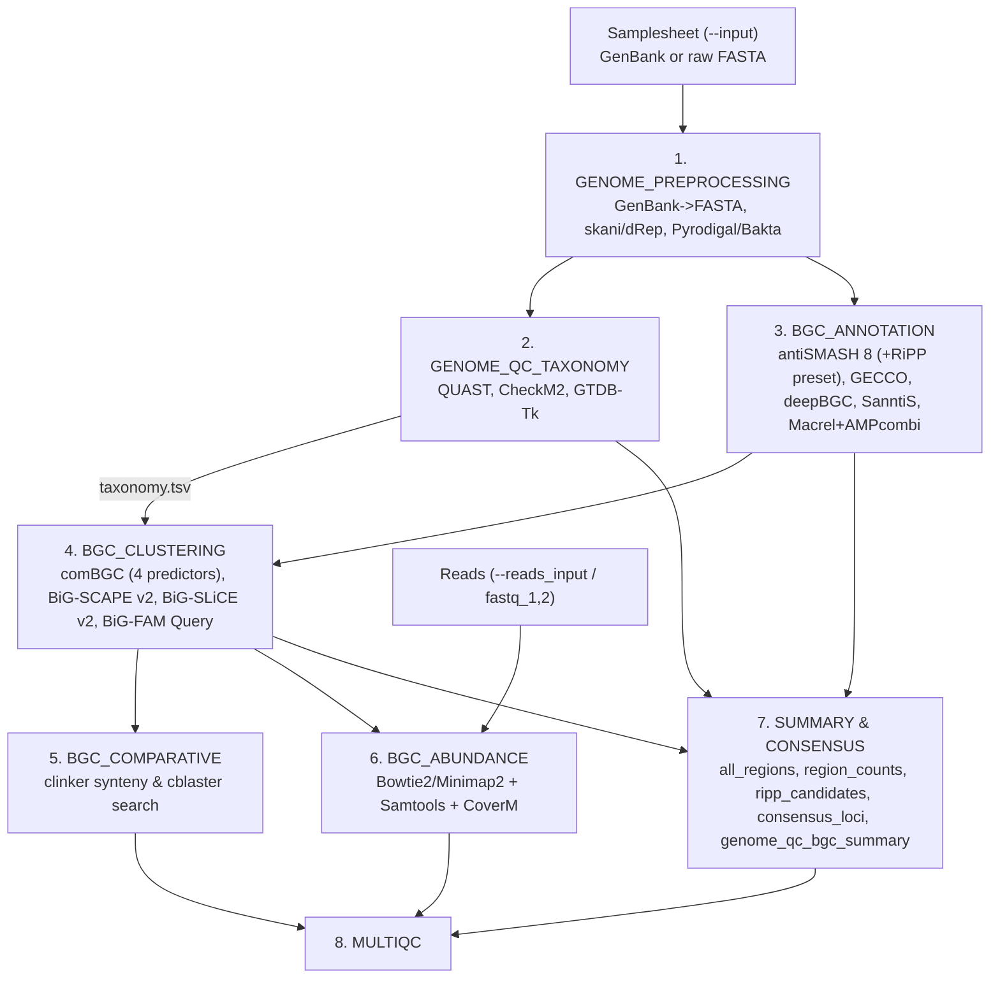

# clystere

**clystere** is a Nextflow pipeline for end-to-end biosynthetic gene cluster (BGC) and antimicrobial peptide (AMP)
discovery, assembly QC, taxonomic annotation, gene cluster family (GCF) clustering, comparative genomics, and
metagenomic/metatranscriptomic abundance quantification.

---

## Overview



---

## Features

- **Tier 1 (Input Flexibility, MAG QC & Taxonomy)**: Automatic Pyrodigal/Bakta pre-annotation on raw FASTA genomes,
  GenBank-to-FASTA extraction, optional QUAST, CheckM2, and GTDB-Tk feeding BiG-SLiCE taxonomy and summaries.
- **Tier 2 (Expanded BGC & Peptide Discovery)**: Parallel antiSMASH 8, GECCO, deepBGC, optional SanntiS (4th predictor),
  Macrel + AMPcombi2 antimicrobial peptides, and `--ripp_preset` with `ripp_candidates.tsv`.
- **Tier 3 (Comparative Genomics & Novelty Scoring)**: Co-executable BiG-SCAPE v2 + BiG-SLiCE v2, BiG-FAM `--query`
  novelty scoring, clinker interactive HTML synteny plots, cblaster cohort/remote neighborhood search, and cross-tool
  consensus locus summary.
- **Tier 4 (Ecological Context)**: Pre-annotation genome dereplication (`skani` / `dRep`) and metagenomic /
  metatranscriptomic BGC & GCF read-mapping matrices (`Bowtie2` / `Minimap2` + `SAMtools` + `CoverM`).

---

## Quick start

```bash
nextflow run andreassag/clystere \
    --input assets/samplesheet.csv \
    --outdir results \
    -profile docker
```

See [Installation](installation.md) and [Usage](usage.md) for full details.
