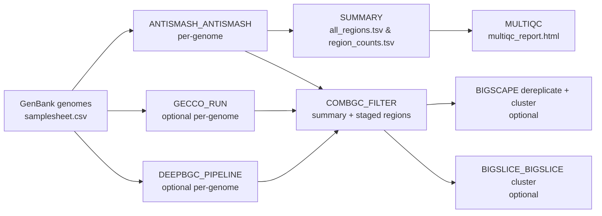

# clystere

**clystere** is a Nextflow pipeline for automated biosynthetic gene cluster (BGC) discovery and comparative analysis. It
runs [antiSMASH](https://antismash.secondarymetabolites.org/), [GECCO](https://github.com/zellerlab/GECCO), and
[deepBGC](https://github.com/Merck/deepbgc) across a collection of bacterial or fungal genomes, aggregates predictions
with [comBGC](https://nf-co.re/funcscan), and optionally groups representative BGCs into gene cluster families (GCFs)
with [BiG-SCAPE](https://github.com/medema-group/BiG-SCAPE) or [BiG-SLiCE](https://github.com/medema-group/bigslice).

---

## Overview



---

## Features

- Parallel antiSMASH + GECCO + deepBGC annotation across GenBank genome files (with optional GFF3 annotation)
- Configurable predictor toggles (`--gecco_run`, `--deepbgc_run`)
- `comBGC.py`-based summary aggregation and sample-prefixed region GBK staging before clustering
- Per-region tabulation (`all_regions.tsv`) and per-genome/per-contig BGC count summary (`region_counts.tsv`)
- MultiQC HTML report aggregating software versions and BGC metrics
- Optional BiG-SCAPE (with optional `bigscape dereplicate`) or BiG-SLiCE (with `BIGSLICE_DOWNLOADDB`) clustering

---

## Quick start

```bash
nextflow run andreassag/clystere \
    --input assets/samplesheet.csv \
    --outdir results \
    -profile docker
```

See [Installation](installation.md) and [Usage](usage.md) for full details.
